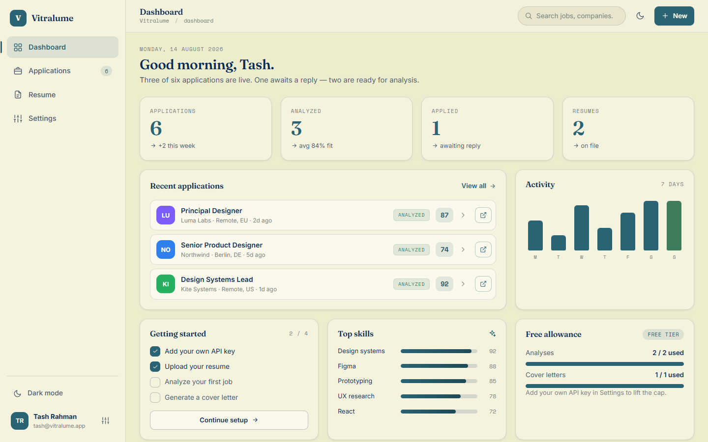
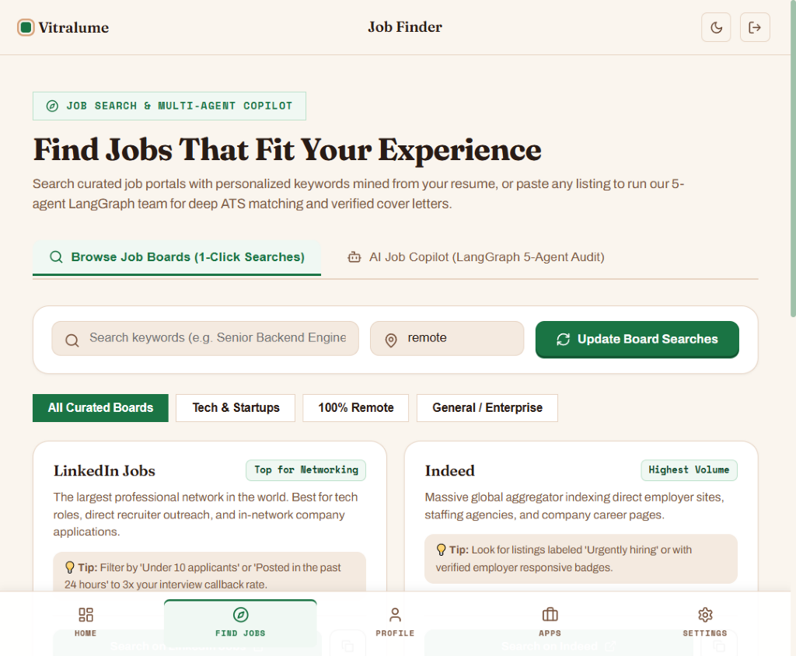
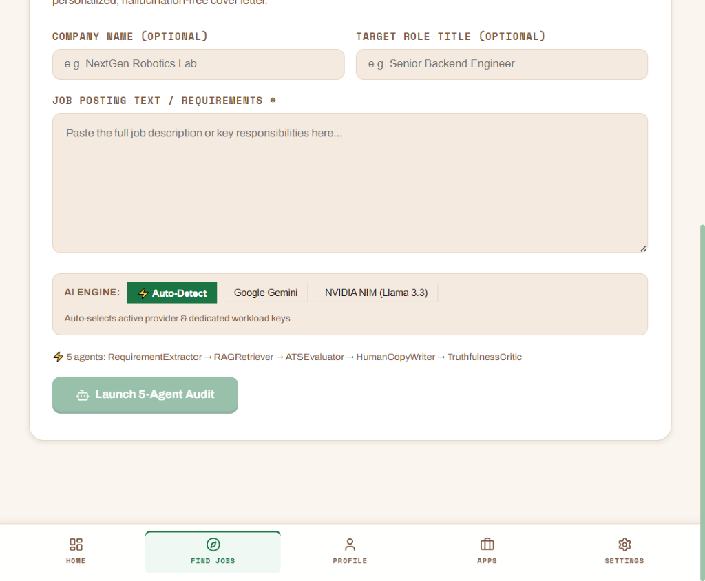
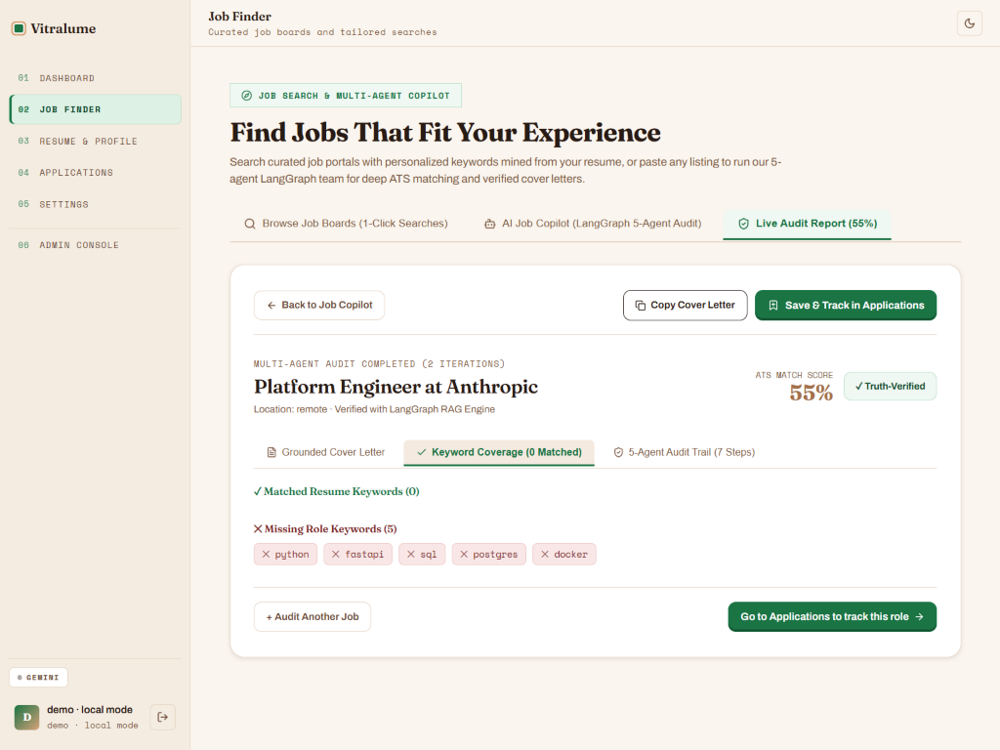
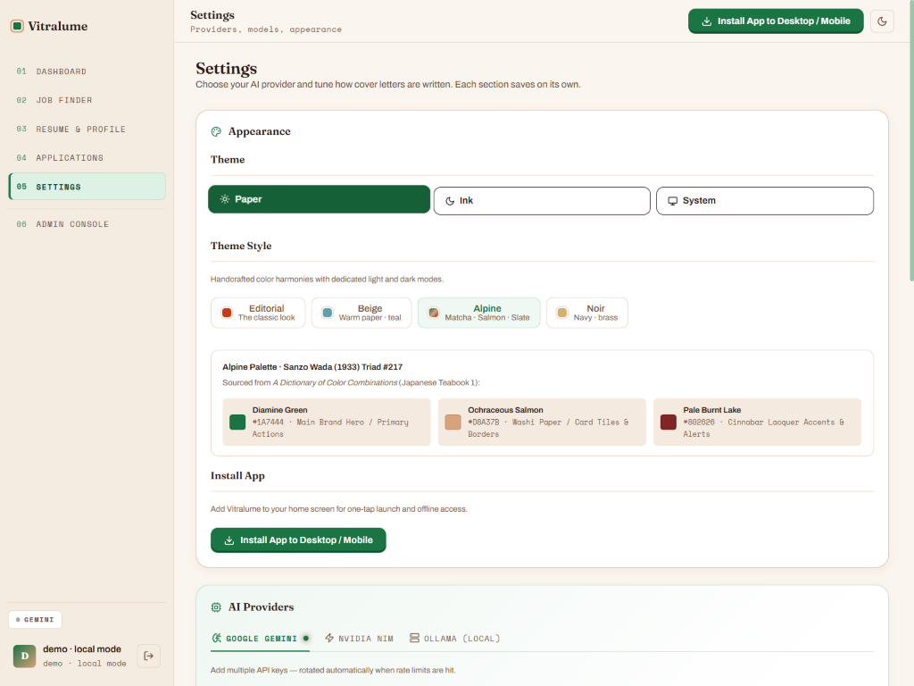
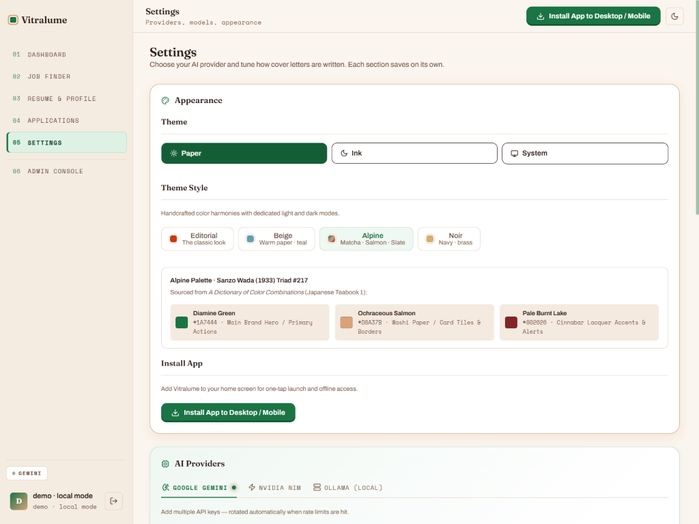
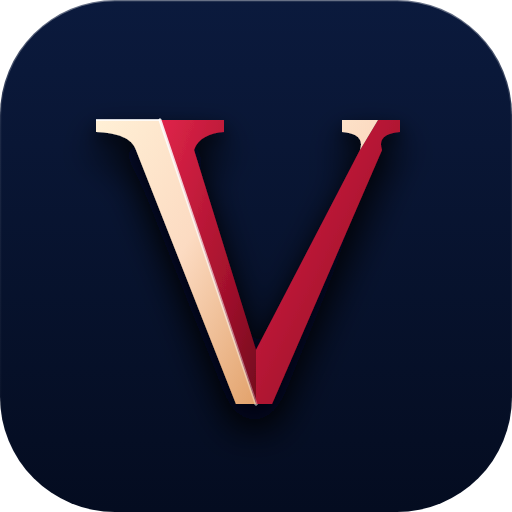
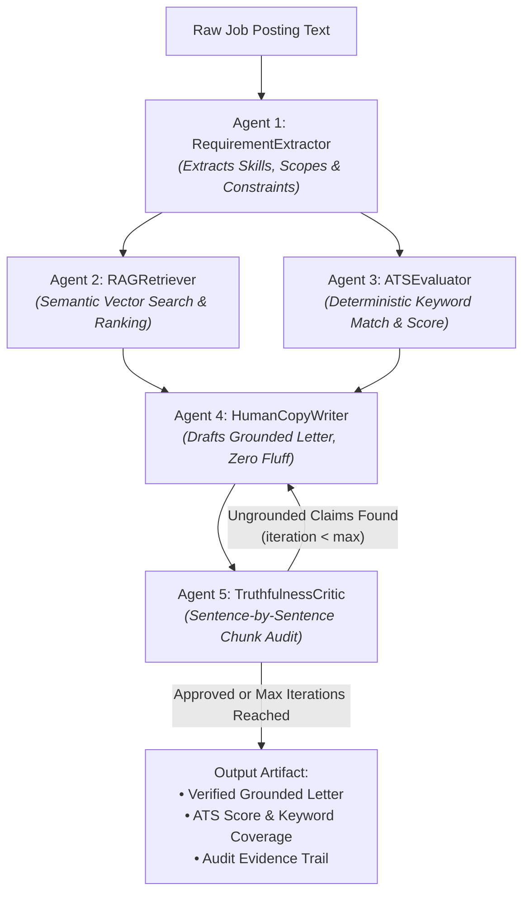

<div align="center">

# Vitralume

### AI Job Application Copilot

**[Live Production Web App](https://vitralume.vercel.app)** · **[Backend API Health](https://job-fit-ai-nzho.onrender.com/health)**

Glass-clear insight into your job fit. Multi-agent ATS keyword evaluation, semantic RAG citation verification, 8-platform job discovery, dual-provider AI workload isolation (Google Gemini + NVIDIA NIM), and hallucination-guarded cover letters.

[](https://react.dev/)
[](https://fastapi.tiangolo.com/)
[](https://langchain-ai.github.io/langgraph/)
[](https://build.nvidia.com/)
[](https://supabase.com/)
[](https://web.dev/progressive-web-apps/)
[](LICENSE)

<br />


</div>

---

## Table of Contents

- [Overview](#overview)
- [Application Gallery](#application-gallery)
- [Core Capabilities](#core-capabilities)
- [Multi-Agent Pipeline Architecture](#multi-agent-pipeline-architecture)
- [Multi-Provider & Dual Keys](#multi-provider--dual-keys)
- [Alpine Design System](#alpine-design-system)
- [Tech Stack](#tech-stack)
- [Quick Start](#quick-start)
- [Testing](#testing)
- [API Endpoints](#api-endpoints)
- [Security & Privacy](#security--privacy)
- [License](#license)

---

##  Overview

Vitralume (*vitral* — stained glass · *lume* — illumination) is a distributed AI copilot designed to eliminate generic, ungrounded applications and ATS rejection:

- **LangGraph 5-Agent Pipeline**: Autonomous state-machine graph dissecting job postings, retrieving verified resume chunks, evaluating ATS compatibility, drafting letters, and auditing factual claims.
- **Deterministic Truthfulness Guard**: Every assertion is cross-checked against indexed resume chunks via cosine similarity with citation tags (`[VERIFIED: EXP § 1]`).
- **Dual-Key & Multi-Provider Isolation**: Dedicated model and quota allocation for Curation/Embeddings vs LangGraph agent reasoning across **Google Gemini** and **NVIDIA NIM** (`meta/llama-3.3-70b-instruct`).
- **Curated Job Finder**: Instant boolean search generation and direct platform deep links across 8 major job platforms.
- **Japanese Teabook Aesthetics**: Color harmonies derived from Sanzo Wada's 1930s classic, Archivo + Fraunces typography, and an installable PWA.

---

##  Application Gallery

<div align="center">

### Executive Dashboard & Application Command Center


<br />

| Job Finder: Curated Board Directory | Job Finder: 5-Agent Copilot |
|:---:|:---:|
|  |  |

<br />

| Live Audit: ATS Score & Grounded Letter | Live Audit: Keyword Gap Analysis |
|:---:|:---:|
|  |  |

<br />

| Multi-Provider Settings (Light) | Multi-Provider Settings (Cool Obsidian Dark) |
|:---:|:---:|
|  |  |

<br />

| Chiseled Roman "V" Brandmark & App Icon | Applications Pipeline Tracker |
|:---:|:---:|
|  |  |
|:---:|:---:|
|  |  |

</div>

---

##  Core Capabilities

### 1. LangGraph Multi-Agent Pipeline
State-machine pipeline with 5 isolated roles:
- **`RequirementExtractor`**: Separates mandatory vs preferred requirements, years of experience, and skill constraints.
- **`RAGRetriever`**: Semantic vector search retrieving section-aware resume evidence (`[EXP]`, `[PUB]`, `[PROJ]`).
- **`ATSEvaluator`**: Calculates deterministic ATS match percentage, keyword frequency, and missing skills.
- **`HumanCopyWriter`**: Writes concise, natural cover letters using only retrieved candidate facts.
- **`TruthfulnessCritic`**: Audits assertions sentence-by-sentence; loops back to writer on ungrounded claims (up to 2 iterations).

### 2. Personalized Job Finder (`/jobs`)
- **Board Directory**: 1-click boolean search queries across 8 platforms (LinkedIn, Indeed, Wellfound, Google Jobs, Y Combinator, RemoteOK, Glassdoor, ZipRecruiter).
- **AI Job Copilot**: Paste any job description, choose provider (`auto`, `gemini`, `nim`), and run the agent team.
- **Live Audit Report**: Real-time ATS match gauge, grounded letter draft, keyword gap analysis, and 1-click application tracking.

### 3. Semantic RAG Engine
- **Section Chunking**: Parses PDF and DOCX files into categorized chunks (experience, education, publications, projects).
- **Vector Embeddings**: Dense embeddings via Gemini `text-embedding-004` with offline unit-sphere fallback.
- **Traceable Citations**: Line-level verification tags linked to candidate records.

### 4. Workload Isolation & Resilience
- **Dual API Keys**: Isolates high-volume embedding tasks from deep multi-turn LLM agent reasoning.
- **Automatic Fallback**: Automatic provider failover on rate limits or service interruptions.

### 5. Progressive Web App (PWA)
- Offline-ready with Workbox service worker caching.
- Native installation on iOS, Android, macOS, and Windows.

---

##  Multi-Agent Pipeline Architecture



---

##  Multi-Provider & Dual Keys

Dedicated keys prevent quota bottlenecks and optimize cost-performance across providers:

- **Google Gemini**: Low-latency embedding generation (`text-embedding-004`) and analysis (`gemini-2.5-flash`).
- **NVIDIA NIM**: High-throughput reasoning with hosted models (`meta/llama-3.3-70b-instruct`).

```env
# Dedicated Workload Keys (Optional Overrides)
CURATION_API_KEY=AIzaSy...              # Resume chunking & embeddings
AGENT_API_KEY=nvapi-...                 # LangGraph 5-agent pipeline

# Server Fallback Keys
GEMINI_API_KEY=AIzaSy...                # Google Gemini
NVIDIA_API_KEY=nvapi-...                # NVIDIA NIM
```

---

##  Alpine Design System

Interface styling rooted in classical color harmonies from Sanzo Wada (Combination #217):

- **Primary Alpine Triad**:
  - **Diamine Green** (`#1A7444`): Primary actions, verified badges, active navigation.
  - **Ochraceous Salmon** (`#D8A37B`): Surface cards, secondary metrics, warm borders.
  - **Pale Burnt Lake** (`#802626`): Skill gap alerts, danger actions, lacquer contrast.
- **Cool Obsidian Dark Mode**: Refined slate cards (`#12171E`) on deep obsidian canvas (`#0B0F13`) with luminous emerald green actions (`#22C55E`) and zero reddish tint.
- **Brandmark (Sanzo Wada #232)**:
  - **Deep Indigo** (`#0D1B2A`), **Gilded Starlight Gold** (`#D4AF37`), and **Carmine Wine** (`#6B1724`).
- **Typography**: **Fraunces** serif display, **Archivo** sans body, and **Space Mono** data tags.

---

##  Tech Stack

| Layer | Technologies |
|---|---|
| **Frontend** | React 19, TypeScript, Vite, Workbox PWA, Lucide Icons, Teabook Design System |
| **Backend** | Python 3.11, FastAPI (ASGI), LangGraph, SQLAlchemy 2.0, Psycopg 3, PyPDF, python-docx |
| **Database & Auth** | PostgreSQL (Supabase Session Pooler), SQLite (local dev), Supabase Auth (JWT) |
| **AI / LLM** | Google Gemini (`google-genai`), NVIDIA NIM (`openai` SDK), Ollama |
| **Security** | AES-256 Fernet key encryption at rest, SlowAPI rate limiting, strict CSP headers |
| **Deployment** | Vercel (Frontend CI/CD), Render (Backend Web Service), GitHub Actions keep-alive |

---

##  Quick Start

### Prerequisites
- Python 3.10+ (3.11 recommended)
- Node.js 18+ and npm
- (Optional) [Google AI Studio Key](https://aistudio.google.com/) or [NVIDIA NIM Key](https://build.nvidia.com/)

### 1. Clone Repository
```bash
git clone https://github.com/Tash000/job-fit-ai.git
cd job-fit-ai
```

### 2. Backend Setup
```bash
cd backend
python -m venv venv
source venv/bin/activate       # Linux/macOS (Windows: venv\Scripts\activate)
pip install -r requirements.txt
python -m uvicorn main:app --reload --port 8000
```
Interactive API documentation: `http://localhost:8000/docs`

### 3. Frontend Setup
```bash
cd ../frontend
npm install
npm run dev
```
Local application: `http://localhost:5173`

---

##  Testing

```bash
# Backend unit & multi-agent test suite (117+ tests)
cd backend
python -m pytest tests/ -v

# Frontend lint, typecheck, and build validation
cd ../frontend
npm run lint          # oxlint static analysis
npm run build         # tsc -b && vite build
npm run csp:check     # Content Security Policy hash verification
```

---

##  API Endpoints

### Multi-Agent & RAG
- `POST /api/pipeline/run-graph` — Executes 5-agent LangGraph workflow (`auto`, `gemini`, `nim`).
- `POST /api/rag/index` — Triggers chunking and vector embedding generation.
- `POST /api/rag/retrieve` — Semantic search retrieving top-K verified resume chunks.
- `POST /api/rag/verify-claim` — Audits a single sentence claim against indexed chunks.

### Job Discovery & Search
- `GET /api/jobs/boards` — Returns curated catalog of supported job boards.
- `GET /api/jobs/personalized-recommendations` — Returns candidate-tailored search recommendations.
- `POST /api/jobs/generate-board-searches` — Generates 1-click boolean search URLs across platforms.

### Core Operations
- `GET /api/applications` & `POST /api/applications` — CRUD for tracked applications.
- `POST /api/analyze` — Suitability evaluation, ATS keyword match, and gap analysis.
- `GET /api/settings` & `PUT /api/settings` — Encrypted key and provider management.

---

##  Security & Privacy

- **Encrypted at Rest**: User provider keys are encrypted with AES-256 (`cryptography.fernet`) and decrypted only in memory for active requests.
- **Row-Level Isolation**: All database operations enforce user UUID scoping.
- **Audited Generations**: Generated letters include verifiable citation tags (`[EXP § 1]`).

---

## License

Distributed under the [MIT License](LICENSE).
