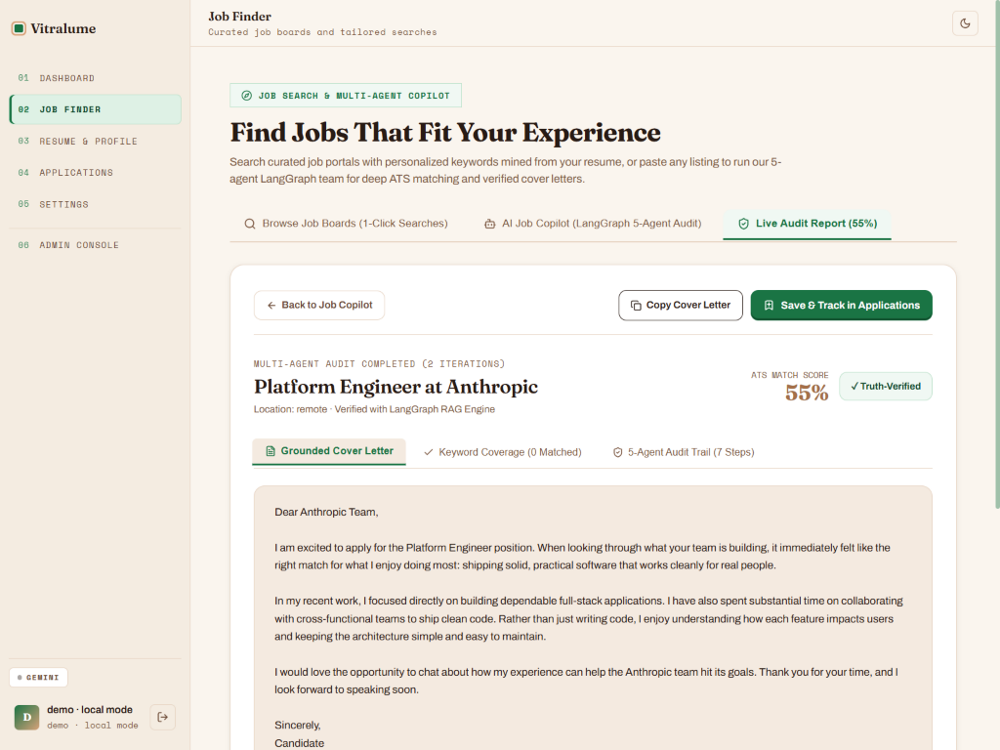
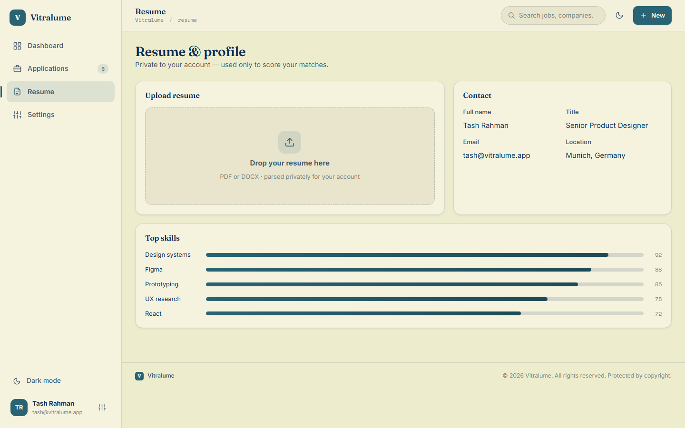

<div align="center">

# 🪟 Vitralume — AI Job Application Copilot

### [Live Production Web App](https://vitralume.vercel.app) · [Backend API Health](https://job-fit-ai-nzho.onrender.com/health)

**Glass-clear insight into your job fit.** Multi-agent ATS keyword evaluation, semantic RAG citation verification, 8-platform job discovery, dual-provider AI workload isolation (Google Gemini + NVIDIA NIM), and hallucination-guarded cover letters.

[](https://react.dev/)
[](https://fastapi.tiangolo.com/)
[](https://langchain-ai.github.io/langgraph/)
[](https://build.nvidia.com/)
[](https://supabase.com/)
[](https://web.dev/progressive-web-apps/)
[](LICENSE)

<br />


</div>

---

## 📖 Table of Contents

- [Overview](#-overview)
- [Application Gallery](#-application-gallery)
- [Core Capabilities](#-core-capabilities)
- [Multi-Agent Pipeline Architecture](#-multi-agent-pipeline-architecture)
- [Dual API Keys & Multi-Provider Architecture](#-dual-api-keys--multi-provider-architecture)
- [Japanese Teabook 1 Design System](#-japanese-teabook-1-design-system)
- [Tech Stack](#-tech-stack)
- [Quick Start & Local Setup](#-quick-start--local-setup)
- [Environment Configuration](#-environment-configuration)
- [API Endpoints](#-api-endpoints)
- [Security & Data Privacy](#-security--data-privacy)
- [Deployment Guide](#-deployment-guide)
- [License](#-license)

---

## 🌟 Overview

**Vitralume** (*vitral* — stained glass · *lume* — illumination) is an AI-architected job application copilot built for software engineers, data scientists, and technical leaders.

What began as a localized script has evolved into a full-scale, production-ready distributed web application. Rather than outputting generic, ungrounded ChatGPT cover letters that trigger automated ATS rejections, Vitralume combines:
1. **LangGraph 5-Agent Pipeline**: Autonomous state-machine graph dissecting job postings, retrieving verified resume chunks, evaluating ATS compatibility, drafting humanized letters, and critiquing factual truthfulness.
2. **Dual-Key & Multi-Provider Isolation**: Dedicated API key and model allocation for **Curation/RAG Embeddings** vs **LangGraph 5-Agent Reasoning**, supporting both **Google Gemini** and **NVIDIA NIM** (`meta/llama-3.3-70b-instruct`).
3. **Deterministic Truthfulness Guard**: Every assertion in generated letters is audited against actual resume chunks via cosine similarity with citation tags (`[VERIFIED: EXP § 1]`).
4. **Personalized Job Finder Suite**: Mines candidate skills to generate 1-click boolean search queries across 8 curated platforms (LinkedIn, Wellfound, Indeed, Google Jobs, Y Combinator, etc.).
5. **Japanese Teabook 1 Aesthetics**: Sanzo Wada #217 & #232 color palettes, Fraunces serif + Archivo typography, and an installable offline-capable PWA with a 3D Roman "V" brandmark.

---

## 📸 Application Gallery

<div align="center">

### Executive Dashboard & Application Command Center


<br />

| Job Finder: 1-Click Curated Board Directory | Job Finder: 5-Agent LangGraph AI Copilot |
|:---:|:---:|
|  |  |

<br />

| Live Audit Report: ATS Gauge & Grounded Letter | Live Audit Report: Keyword Coverage & Gap Analysis |
|:---:|:---:|
|  |  |

<br />

| Multi-Provider Settings (Gemini & NVIDIA NIM) | Chiseled 3D Roman "V" Brandmark & App Icon |
|:---:|:---:|
|  |  |

<br />

| Applications Pipeline Tracker | Structured Resume Profile & Skills Editor |
|:---:|:---:|
|  |  |

</div>

---

## ⚡ Core Capabilities

### 1. 🤖 LangGraph Multi-Agent Pipeline
Vitralume deploys a state-machine multi-agent graph with 5 specialized personas:
* **`RequirementExtractor`**: Isolates mandatory vs. preferred requirements, years of experience, and hard skill constraints from raw job postings.
* **`RAGRetriever`**: Performs semantic search across section-aware resume chunks (`[EXP]`, `[PUB]`, `[PROJ]`) to surface factual evidence.
* **`ATSEvaluator`**: Calculates deterministic ATS match percentage, keyword frequency, and identifies missing skills.
* **`HumanCopyWriter`**: Generates natural, human-sounding cover letters (A2/B1 readability) using only retrieved resume facts.
* **`TruthfulnessCritic`**: Audits every sentence. If an ungrounded claim is detected, it loops back to the writer for revision (up to 2 iterations).

### 2. 🧭 Personalized Job Finder (`/jobs`)
* **3-Tab Experience**:
  * **Tab 1: Browse Job Boards**: 1-click deep links across 8 curated platforms (LinkedIn, Indeed, Wellfound, Google Jobs, Y Combinator, RemoteOK, Glassdoor, ZipRecruiter) plus copyable boolean queries.
  * **Tab 2: AI Job Copilot**: Paste any job description, choose your preferred AI Engine (Auto, Gemini, or NVIDIA NIM), and launch the 5-agent team.
  * **Tab 3: Live Audit Report**: Real-time ATS match gauge, grounded letter draft, keyword gap analysis, and 1-click **Save & Track in Applications**.

### 3. 🔍 Semantic RAG Engine
* **Section-Aware Chunking**: Automatically breaks uploaded PDFs and text resumes into atomic chunks categorized by experience, publications, projects, and education.
* **Vector Embeddings**: Generates dense embeddings using Gemini text-embedding-004 with a deterministic unit-sphere fallback for offline development.
* **Citation Traceability**: Embeds evidence markers into every generation step.

### 4. 🔑 Dual API Keys & Workload Isolation
* **Zero Rate-Limit Collisions**: Use one key for high-frequency resume parsing & RAG embedding, and a separate key (or provider) for deep LangGraph agent reasoning.
* **Multi-Provider Flexibility**: Switch seamlessly between Google Gemini and NVIDIA NIM (`https://integrate.api.nvidia.com/v1`).

### 5. 📱 Installable PWA (Progressive Web App)
* Offline access powered by Workbox service worker precaching.
* Add to home screen on iOS, Android, macOS, and Windows with standalone desktop windowing.

---

## 🏗 Multi-Agent Pipeline Architecture


---

## 🔌 Dual API Keys & Multi-Provider Architecture

Vitralume supports dedicated API keys for different workloads to prevent rate-limit contention, separate costs, and take advantage of specialized foundation models:

### Why Use Two Different API Keys?
1. **Workload Separation**: Embedding generation (Curation / RAG) requires different API quotas than multi-turn LLM generation (LangGraph 5-Agent pipeline).
2. **Provider Optimization**:
   * **Google Gemini**: Exceptional context window and low latency for embedding computation (`text-embedding-004`) and analysis (`gemini-2.5-flash`).
   * **NVIDIA NIM**: High-throughput enterprise LLM execution hosting `meta/llama-3.3-70b-instruct` or `meta/llama-3.1-8b-instruct`.
3. **Failover Resilience**: If one provider encounters a rate limit or service interruption, Vitralume automatically falls back to the secondary provider.

### Environment Configuration for Dedicated Keys:
```env
# ── Dedicated Workload Keys (Optional Overrides) ──
CURATION_API_KEY=AIzaSy...              # Dedicated key for resume chunking & embeddings
AGENT_API_KEY=nvapi-...                 # Dedicated key for LangGraph 5-agent pipeline

# ── General Server Fallback Keys ──
GEMINI_API_KEY=AIzaSy...                # Google Gemini API Key
NVIDIA_API_KEY=nvapi-...                # NVIDIA NIM API Key
```

---

## 🎨 Japanese Teabook 1 Design System

The Vitralume interface is built around classical Japanese color harmonies documented by Sanzo Wada:

* **Primary Application Palette (Sanzo Wada #217)**:
  * **Diamine Green** (`#1A7444`): Primary buttons, verified badges, focus outlines.
  * **Ochraceous Salmon** (`#D8A37B`): Secondary metrics, warm highlights, accent borders.
  * **Pale Burnt Lake** (`#802626`): Missing skill tags, danger buttons, alert banners.
* **Chiseled Roman "V" Brandmark (Sanzo Wada #232)**:
  * **Deep Indigo** (`#0D1B2A`): Background shield and depth gradient.
  * **Gilded Starlight Gold** (`#D4AF37`): Chiseled 3D Roman "V" chevron facets.
  * **Carmine Wine** (`#6B1724`): Inner contrast anchor.
* **Micro-Interactions**: Springy bubble clicks (`transform: scale(0.97)`), softened border radiuses (`--radius-xl: 18px`), and accessible contrast ratios.

---

## 🧰 Tech Stack

| Layer | Technologies |
|---|---|
| **Frontend** | React 19, TypeScript, Vite, Workbox PWA, Lucide React, Japanese Teabook 1 Theme |
| **Backend** | Python 3.10+, FastAPI (ASGI), LangGraph, SQLAlchemy 2.0, Psycopg 3, PyPDF, python-docx |
| **Database & Auth** | PostgreSQL (Supabase Session Pooler), SQLite (local dev), Supabase Auth (JWT) |
| **AI / LLM** | Google Gemini (`google-genai`), NVIDIA NIM (`openai` SDK / `integrate.api.nvidia.com`), Ollama |
| **Security** | AES-256 Fernet key encryption at rest, SlowAPI rate limiting, strict CSP headers |
| **Deployment** | Vercel (Frontend CI/CD), Render (Backend Web Service), GitHub Actions keep-alive |

---

## 🚀 Quick Start & Local Setup

### Prerequisites
* Python 3.10+ (Python 3.11 recommended)
* Node.js 18+ and npm
* (Optional) [Google AI Studio API Key](https://aistudio.google.com/) and/or [NVIDIA NIM API Key](https://build.nvidia.com/)

### 1. Clone the Repository
```bash
git clone https://github.com/Tash000/job-fit-ai.git
cd job-fit-ai
```

### 2. Backend Setup
```bash
cd backend

# Create and activate virtual environment
python -m venv venv
venv\Scripts\activate       # Windows
source venv/bin/activate     # Linux/macOS

# Install dependencies
pip install -r requirements.txt

# Start backend server in DEMO mode (zero config needed)
python -m uvicorn main:app --reload --port 8000
```
* API interactive docs: `http://localhost:8000/docs`

### 3. Frontend Setup
```bash
cd ../frontend

# Install dependencies
npm install

# Start Vite development server
npm run dev
```
* Frontend application: `http://localhost:5173`

---

## 🧪 Running Tests

### Backend Unit & Multi-Agent Tests (117+ tests)
```bash
cd backend
python -m pytest tests/ -v
```
Feature suites include:
* `test_agent_graph.py` — LangGraph multi-agent execution, node transitions, and dual-provider routing.
* `test_rag.py` — Section chunking, vector embeddings, and cosine verification.
* `test_job_search.py` — Resume keyword mining and boolean search URL generation.
* `test_settings_keys.py` — Multi-provider key encryption, storage, and masking.

### Frontend Validation & Production Build
```bash
cd frontend
npm run lint          # Fast oxlint code quality check
npm run build         # Typecheck (tsc -b) and production bundle build
npm run csp:check     # Content Security Policy hash verification
```

---

## 📡 API Endpoints

### Multi-Agent & RAG Endpoints
* `POST /api/pipeline/run-graph` — Executes the 5-agent LangGraph workflow with provider selection (`auto`, `gemini`, `nim`).
* `POST /api/rag/index` — Triggers chunking and vector embedding generation for candidate profile.
* `POST /api/rag/retrieve` — Semantic search retrieving top-K verified evidence chunks.
* `POST /api/rag/verify-claim` — Audits a single sentence assertion against indexed resume chunks.

### Job Search & Board Directory
* `GET /api/jobs/boards` — Returns the curated catalog of supported job boards.
* `GET /api/jobs/personalized-recommendations` — Mines resume skills and returns tailored search targets.
* `POST /api/jobs/generate-board-searches` — Generates direct 1-click boolean search URLs across platforms.

### Core Application Endpoints
* `GET /api/applications` & `POST /api/applications` — CRUD for tracked job applications.
* `POST /api/analyze` — Evaluates suitability, ATS keyword match, and strength/gap breakdown.
* `GET /api/settings` & `PUT /api/settings` — Manages multi-provider encrypted keys and models.

---

## 🔐 Security & Data Privacy

* **Zero Plaintext Stored**: User provider keys are encrypted with AES-256 (`cryptography.fernet`). Decrypted in memory strictly for the active request.
* **Per-Account Row Level Isolation**: All queries enforce user UUID scoping.
* **Hallucination Shield**: Generated cover letters cite indexed evidence chunks (`[EXP § 1]`).

---

## 📄 License

This project is open-source and licensed under the [MIT License](LICENSE).
